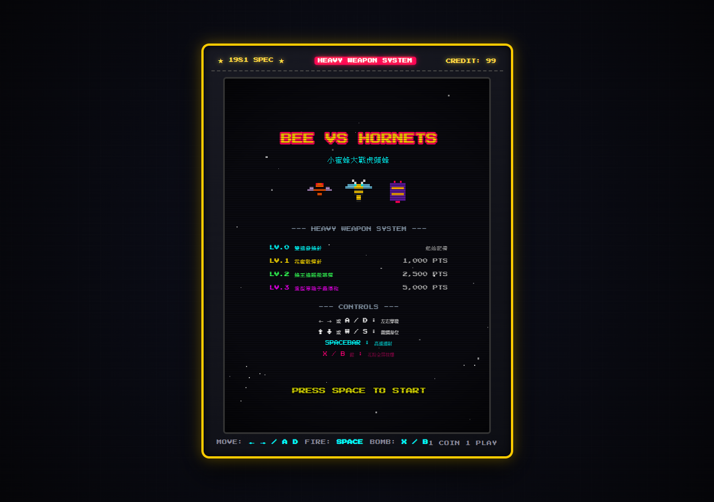
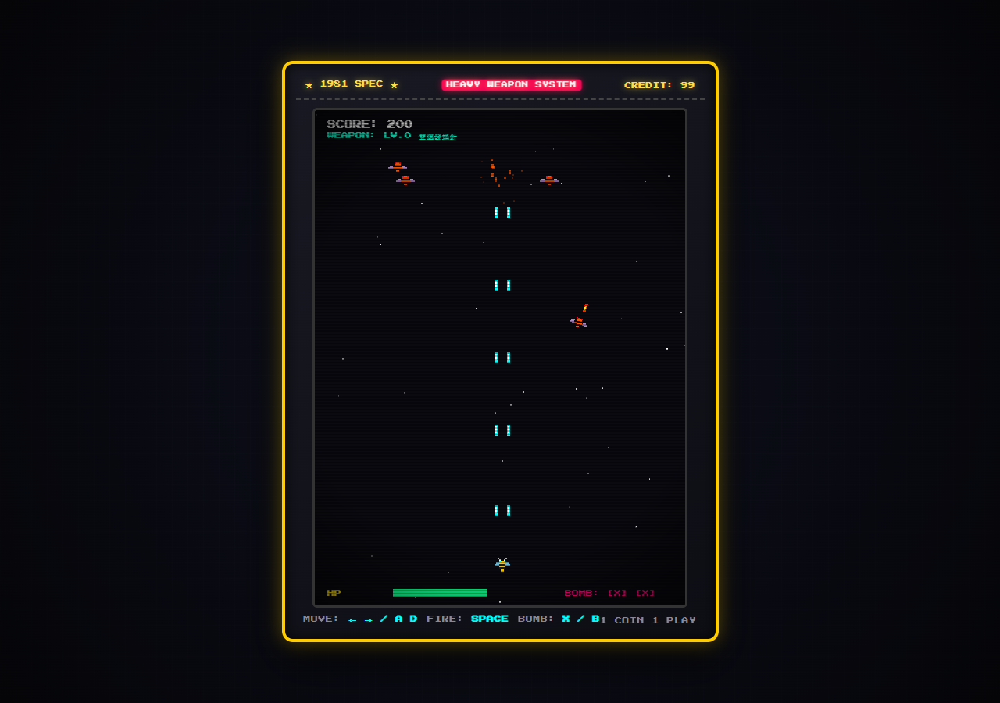

# 🐝 小蜜蜂大戰虎頭蜂 (Bee vs Hornets)

[](https://opensource.org/licenses/MIT)
[](https://phaser.io/)
[](https://bee-vs-hornets.pages.dev/)
[](https://tw365-org.github.io/bee-vs-hornets/)
[](https://github.com/tw365-org/bee-vs-hornets/actions)

> 一款基於 **Phaser 3** 與 **原生 ES Modules (ESM)** 打造的復古 8-Bit 像素街機彈幕射擊遊戲。  
> 具備 **4 階重武器進階系統**、**程序化像素紋理動態生成**、**Web Audio 晶片合成音效**、**花粉核爆必殺技** 與 **東方蜂鷹天敵救援彩蛋**。  
> 專為零構建 (Zero-Build) 設計，隨開即玩，支援直接部署至 **Cloudflare Pages** 與 **GitHub Pages**！

### 🕹️ 線上立即暢玩 (Play Online Instantly)
- ⚡ **Cloudflare 邊緣極速節點**：👉 [https://bee-vs-hornets.pages.dev/](https://bee-vs-hornets.pages.dev/)
- 🐙 **GitHub Pages 官方鏡像**：👉 [https://tw365-org.github.io/bee-vs-hornets/](https://tw365-org.github.io/bee-vs-hornets/)

---

## 📸 遊戲實機畫面 (Screenshots)

| 🕹️ 復古街機主選單 (Title Menu) | ⚔️ 彈幕激戰與重武器進階 (Gameplay) |
|:---:|:---:|
|  |  |

---

## 🎮 遊戲特點 (Features)

- 🕹️ **經典街機手感**：CRT 掃描線濾鏡、8-Bit 點陣字體與懷舊像素微光特效。
- ⚡ **4 階重武器進階系統**：隨分數突破自動升級，從雙連發蜂針、花蜜散彈、蜂王追蹤微導彈，一路解鎖至毀滅性的等離子重砲！
- 💥 **花粉天譴核爆 (Pollen Supernova)**：累積能量後一鍵全螢幕肅清敵機與彈幕。
- 👾 **高智能敵機編隊與越位回馬槍 (Predator AI)**：普通工蜂陣型巡邏俯衝、重型裝甲蜂散射尾針、多階段變態狂暴的虎頭蜂女王 (Queen Boss)。更具備自然界捕食特徵——**越位後急停甩尾 180 度逆向背刺回咬**！
- 📈 **獨立波次難度縮放器 (WaveDifficultyManager)**：模組化難度演算法，隨波次動態平滑遞增敵機移速、射擊頻率與越位回馬槍機率（Wave 1~2 暖身，Wave 3+ 兇猛爆發）。
- 🎨 **100% 程式化像素美術 (Procedural Pixel Art)**：遊戲內建 Canvas 像素繪製引擎，零靜態外部圖片依賴，永遠不會遇到 404 斷圖。
- 🔊 **Web Audio 晶片級即時合成**：方波射擊、白噪聲爆炸、A Major 升級琶音，無外連音檔載入延遲。
- 🦅 **大自然食物鏈彩蛋 (Oriental Honey Buzzard Rescue)**：當小蜜蜂瀕死 (HP ≤ 25%) 或 Boss 戰陷入苦戰時，虎頭蜂的天敵——**東方蜂鷹**會長嘯破雲而降，以霸氣俯衝橫掃群蜂並空投「特級蜂露」實施大自然生態救援！
- 🚀 **雲端與開源友善**：零打包配置（No Webpack/Vite required），已設定好 GitHub Actions CI/CD，同時支援 **Cloudflare Pages** 與 **GitHub Pages**！

---

## 🕹️ 操作控制 (Controls)

> 💡 **提示**：本專案為復古街機沉浸體驗設計，**支援鍵盤與 Gamepad（手把），建議在桌機或筆電上遊玩**（依產品定位 D1，不支援行動觸控）。

| 操作動作 | 鍵盤按鍵 | Gamepad (手把 / 搖桿) |
|:---|:---:|:---:|
| **左右靈巧穿梭飛行** | <kbd>←</kbd> <kbd>→</kbd> 或 <kbd>A</kbd> <kbd>D</kbd> | 左類比搖桿 (左/右) 或 十字鍵 |
| **上下微調走位防空** | <kbd>↑</kbd> <kbd>↓</kbd> 或 <kbd>W</kbd> <kbd>S</kbd> | 左類比搖桿 (上/下) 或 十字鍵 |
| **高速連射主武器蜂針** | <kbd>SPACE</kbd> (空白鍵，按住) | <kbd>A</kbd> 鍵 (按住連射) |
| **花粉天譴全屏核爆** | <kbd>X</kbd> 或 <kbd>B</kbd> (單發) | <kbd>B</kbd> 或 <kbd>X</kbd> 鍵 (單發) |
| **開始遊戲 / 重新開始** | <kbd>SPACE</kbd> 或 滑鼠點擊 | <kbd>A</kbd> 鍵 或 <kbd>START</kbd> 鍵 |

---

## ⚔️ 重武器套件系統 (Heavy Weapon System)

| 等級 | 解鎖分數 | 武器名稱 | 特性描述 | 彈幕特效 |
|:---:|:---:|:---|:---|:---|
| **LV.0** | 0 PTS | **雙連發蜂針** | 初始標配雙軌蜂針，高射速、筆直射線 | 青色雷射 |
| **LV.1** | 1,000 PTS | **花蜜散彈針** | 5 條扇形散射蜂針，大幅增加打擊廣度 | 金黃菱形擴散 |
| **LV.2** | 2,500 PTS | **蜂王追蹤微導彈** | 雙針 + 2 枚具備主動導引功能的微型巡弋飛彈 | 綠色推進火焰飛彈 |
| **LV.3** | 5,000 PTS | **重型等離子轟爆砲** | 穿透型巨型電漿光球，附帶電弧與範圍貫穿傷害 | 紫粉巨型能量球 |
| **SP** | 炸彈圖示 | **花粉天譴核爆** | 清除全場敵方彈幕，並秒殺或重創全螢幕敵人 | 全屏金粉暴風 |
| **EASTER** | 危急時刻 | **東方蜂鷹天降神援** | 虎頭蜂天敵空襲，對掠過普通敵蜂造成 150 點秒殺、對女王 Boss 造成一次性 250 點重創，並空投特級蜂露回復 +50 HP 與補給核彈 | 巨翼俯衝與金色火花 |

---

## 📂 專案架構 (Project Structure)

```
bee-vs-hornets/
├── .github/workflows/
│   └── deploy-pages.yml        # GitHub Pages 自動化佈署 CI/CD 工作流
├── index.html                  # 遊戲首頁入口 (包含小蜜蜂專屬 SVG Favicon 與 Phaser 3 CDN)
├── _headers                    # Cloudflare Pages 快取與安全標頭配置
├── LICENSE                     # MIT 開源授權條款
├── README.md                   # 專案詳細說明文檔
├── css/
│   └── style.css               # 街機外框、CRT 掃描線、微光 Glow 樣式
└── src/
    ├── config.js               # 遊戲全域平衡設定與武器門檻配置
    ├── main.js                 # 啟動腳本，實例化 Phaser.Game
    ├── audio/
    │   └── SoundManager.js     # Web Audio 8-Bit 晶片合成音效引擎
    ├── gfx/
    │   └── TextureGenerator.js # 原生 Canvas 程式化像素精靈繪製器
    ├── entities/
    │   ├── Player.js           # 玩家小蜜蜂 (移動、護盾、大絕)
    │   ├── Hornet.js           # 普通虎頭蜂 (編隊、波浪俯衝 AI)
    │   ├── ArmoredHornet.js    # 裝甲巨蜂 (高耐久、散射尾針)
    │   └── QueenBoss.js        # 虎頭蜂女王 (多階段 Boss、召喚護衛、雷射掃射)
    ├── systems/
    │   └── WaveDifficultyManager.js # 獨立波次難度曲線與 AI 攻擊行為管理器
    ├── weapons/
    │   ├── WeaponSystem.js     # 重武器里程碑狀態機與子彈物件池
    │   └── Bullet.js           # 子彈物理碰撞與導引邏輯
    ├── ui/
    │   └── HUD.js              # 街機抬頭顯示器 (HP、武器位階、炸彈、Boss血條)
    └── scenes/
        ├── BootScene.js        # 動態紋理繪製與資源啟動
        ├── MenuScene.js        # 街機標題畫面與投幣說明
        ├── GameScene.js        # 戰鬥主迴圈、波次循環、碰撞監聽
        └── GameOverScene.js    # 結算評級 (S/A/B/C) 與重新開局
```

---

## 💻 本地運行 (Local Development)

由於本專案採用原生 ES 模組 (ESM) 架構，需透過本地 HTTP 靜態伺服器開啟以避免瀏覽器 CORS 限制：

```bash
# 使用 Python (推薦)
python -m http.server 8080

# 或使用 Node.js
npx serve .
```
接著在瀏覽器打開 `http://localhost:8080` 即可暢玩。

---

## 🌐 部署至 Cloudflare Pages (Deploy to Cloudflare)

本專案採用純靜態 ESM 架構，完美契合 Cloudflare Pages 的全球邊緣加速網路：

### 步驟 1：推送到 GitHub
請參考下方「開源至 GitHub」步驟，將代碼推送至您的 GitHub Repository。

### 步驟 2：在 Cloudflare Pages 建立專案
1. 登入 [Cloudflare Dashboard](https://dash.cloudflare.com/)。
2. 進入 **Workers & Pages** > 點擊 **Create application** > 選擇 **Pages**。
3. 點選 **Connect to Git** 並授權存取您的 GitHub `bee-vs-hornets` 專案。
4. 設定建置參數 (Build Settings)：
   - **Framework preset**: `None`
   - **Build command**: *（保持完全留空）*
   - **Build output directory**: `/` *（代表根目錄）*
5. 點擊 **Save and Deploy**！
> ⏱️ 幾秒鐘內即可完成部署，取得類似 `https://bee-vs-hornets.pages.dev` 的全球 CDN 網址！

---

## 🐙 開源至 GitHub (Publish to GitHub)

在專案目錄下打開終端機 (PowerShell / Git Bash)，執行以下指令：

```bash
# 1. 初始化 Git 倉庫
git init

# 2. 加入所有檔案
git add .

# 3. 提交首次版本
git commit -m "feat: initial release of Bee vs Hornets arcade game built with Phaser 3 & ESM"

# 4. 關聯遠端 GitHub 倉庫
git branch -M main
git remote add origin https://github.com/tw365-org/bee-vs-hornets.git

# 5. 推送代碼
git push -u origin main
```

---

## 📜 開源協議 (License)

本專案採用 [MIT License](LICENSE) 開源授權，歡迎自由修改、分發與用於個人或商業專案。
